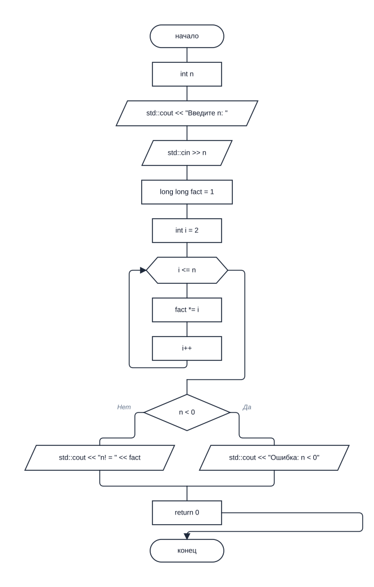

# gostflow

### Блок-схемы алгоритмов C++ по ГОСТ 19.701-90

Вставьте исходный код или укажите `.cpp` файл — gostflow построит блок-схему, которую можно открыть в браузере или сохранить в SVG и PNG.



**Две версии в одном проекте:** браузерное приложение на JavaScript запускается без установки, а Python-версия умеет работать из командной строки и предоставляет локальный веб-интерфейс. Код остаётся на вашем компьютере.

---

## Быстрый старт: браузер

Откройте [`index.html`](index.html) в современном браузере. Установка и сервер не нужны.

1. Вставьте код C++ или выберите пример.
2. Нажмите **Построить** или `Ctrl+Enter`.
3. Скачайте результат в SVG или PNG.

Редактор поддерживает подсветку номеров строк, переключение между функциями, масштабирование и панорамирование схемы. Исходный код хранится в `localStorage` браузера.

## Быстрый старт: Python

Нужен Python 3.10 или новее и Graphviz (`dot`) для раскладки схемы.

```bash
sudo apt install graphviz
python3 run.py samples/factorial.cpp --format svg
```

Чтобы открыть локальный веб-интерфейс:

```bash
python3 run.py --serve --open
```

Установка пакета необязательна. Для команды `gostflow` установите его в виртуальное окружение:

```bash
python3 -m venv .venv
source .venv/bin/activate
pip install -e .
gostflow samples/factorial.cpp --format svg
```

PNG можно экспортировать при установленном `rsvg-convert` или ImageMagick.

## Возможности

- Распознаёт функции и методы C++, ветвления, циклы, `switch`, `try/catch`, `return`, `break` и `continue`.
- Использует фигуры блок-схем по ГОСТ: начало/конец, процесс, решение, ввод/вывод, вызов подпрограммы и граница цикла.
- Поддерживает несколько функций и позволяет строить схему выбранной функции.
- Экспортирует схемы в SVG и PNG.
- Включает примеры C++ в каталоге [`samples/`](samples/).
- Не отправляет исходный код в сеть.

## Примеры команд

```bash
# Список функций в файле
python3 run.py samples/switch.cpp --list

# Схема выбранной функции
python3 run.py samples/loops.cpp --function main -o loops.svg

# SVG и PNG
python3 run.py samples/factorial.cpp --format both

# Номера исходных строк в блоках
python3 run.py samples/factorial.cpp --line-numbers
```

Для Python API:

```python
from gostflow import generate_svg

svg, functions, selected = generate_svg(
    source,
    function="main",
    title="Факториал",
)
```

## Структура проекта

```text
index.html, styles.css   браузерный интерфейс
js/                      парсер, компоновка, SVG и примеры на JavaScript
gostflow/                 парсер, компоновка, рендерер и веб-интерфейс Python
samples/                  примеры исходников и диаграмма factorial
tests/                    smoke-проверки Python-версии
run.py                    запуск Python-версии без установки
```

## Ограничения

Генератор строит схему по структуре кода и не исполняет программу. Это поддерживаемое подмножество C++, поэтому некоторые сложные конструкции могут отображаться одним блоком или не влиять на связи: например, тело лямбды не раскрывается, а потоки исключений `try/catch` не моделируются отдельно. SVG можно доработать в любом векторном редакторе.

## Лицензия

[MIT](LICENSE)
